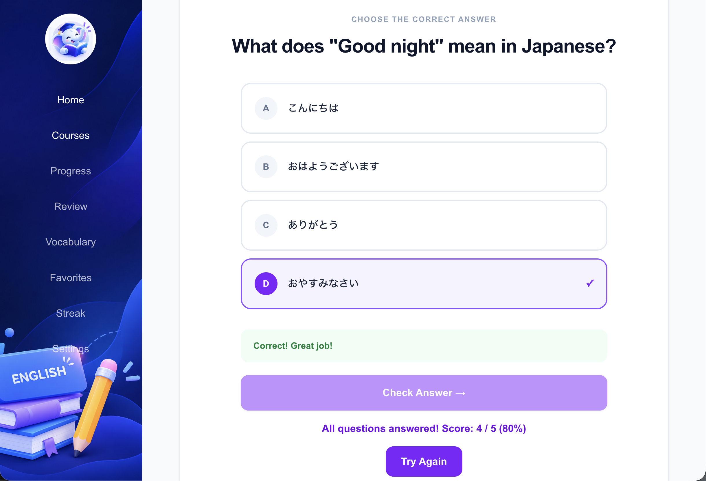
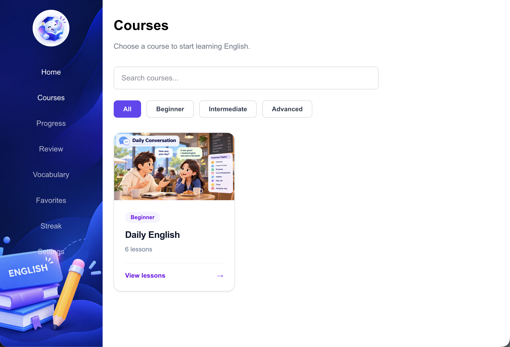
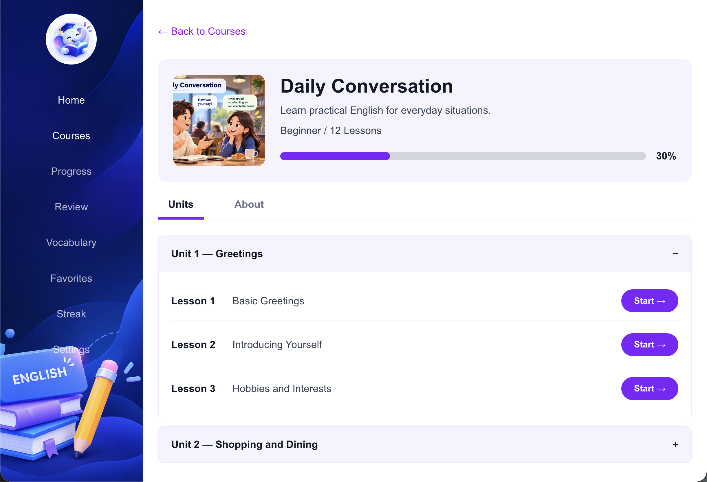
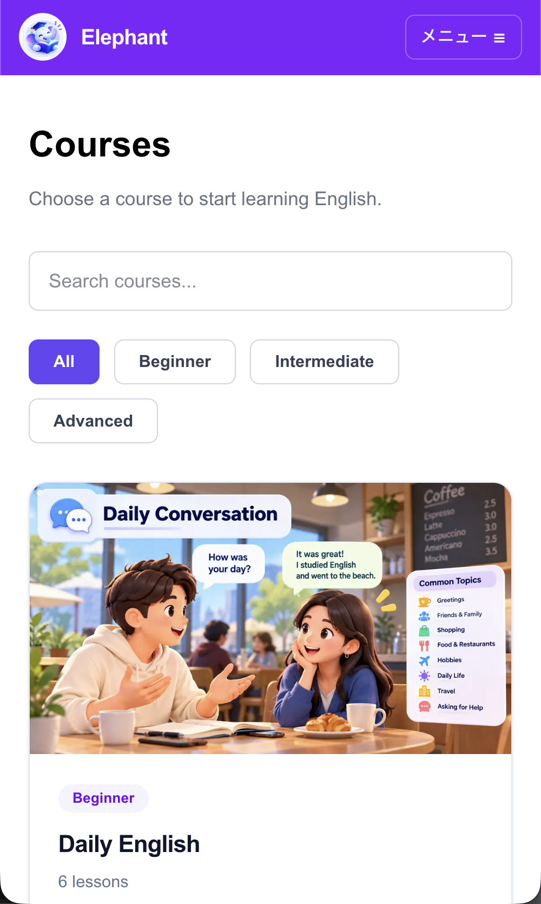

# 🐘 Elephant — English Learning Application

Elephantは、日本語話者向けの英語学習Webアプリケーションです。コースとレッスンを選んで4択クイズに挑戦し、回答ごとの正誤と最終スコアを確認できます。フロントエンドはNext.js、バックエンドはLaravelで開発しています。

学習履歴の保存・XP付与・進捗集計のAPIも実装済みです。現在のクイズ画面は履歴を保存しない単問採点APIを使用しており、学習履歴・XPのAPIとの接続は今後の開発項目です。



**操作の流れ：** コース一覧 → Daily English → レッスンを選択 → クイズ

4つの選択肢から回答を選び、「Check Answer」で正誤を確認します。全問回答後にはスコアを表示し、「Try Again」で再挑戦できます。画像は5問中4問正解（80%）の表示例です。

## 画面紹介

コースを選び、ユニット内のレッスンから4択クイズに進みます。回答後は正誤を確認でき、全問回答すると正解数・正解率が表示されます。

### トップページ

英語学習サービスの紹介ページです。象のロゴと青・紫を基調としたビジュアルで、レッスンや毎日の学習、進捗管理、AI英会話のコンセプトを紹介しています。登録・ログイン画面は実装済みです。AI英会話は今後実装予定です。


### コース一覧（PC）

コース名の検索と、All・Beginner・Intermediate・Advancedの難易度フィルターに対応しています。カードにはコース画像・難易度・コース名・レッスン数を表示し、「View lessons」から詳細へ進めます。デモデータでは初級の「Daily English」（6レッスン）を表示します。



### コース詳細

ユニットごとにレッスン一覧を表示し、「Start」からクイズを開始できます。画像では「Greetings」のレッスンと「Shopping and Dining」のユニットを表示しています。

コース概要には仮データが残っており、画像内の「Daily Conversation」「12 Lessons」「30%」は実際のデモ教材名・レッスン数・学習進捗を反映していません。Seederで登録する教材は「Daily English」、2ユニット・6レッスンです。



### コース一覧（モバイル）

狭い画面では上部にロゴとメニューボタンを配置し、検索欄・難易度フィルター・コースカードを縦に並べて表示します。



## 現在の実装状況

| 機能 | 実装状況 |
| --- | --- |
| トップページ | サービス紹介・学習機能の紹介画面を実装 |
| コース一覧 | APIから取得し、コース名検索・難易度フィルター・再読み込みに対応 |
| コース詳細 | タイトル・説明・画像は仮データ。進捗率は仮の固定値（30%）で、実際の学習進捗とは連動していません。ユニット・レッスン一覧はAPIから取得 |
| クイズ画面 | APIから問題・選択肢を取得し、回答の正誤判定、次の問題への移動、スコア表示、再挑戦に対応 |
| ユーザー認証 | 登録・ログイン・ログアウトのバックエンド処理と、登録・ログイン画面からのセッション認証を実装 |
| 学習履歴・XP | 認証付きのクイズ開始・回答保存・終了APIを実装。現在のクイズ画面からは未接続 |
| 学習進捗 | 合計XP・レベル・完了レッスン数・平均スコアを返すAPIを実装。画面は未実装 |
| 復習 | 完了済みクイズの誤答を問題単位で重複除外して返すAPIを実装。画面は未実装 |

現在のクイズ画面は、履歴を保存しない単問採点APIを使用しています。画面で全問回答しても、学習履歴の保存やXPの付与は行われません。また、トップページで紹介しているAI英会話は未実装です。

## バックエンドの設計

- **回答の検証：** クイズの所有者・進行状態、問題とレッスンの関連、選択肢と問題の関連、同じ問題への重複回答を確認します。別の問題に属する選択肢の送信は拒否します。
- **クイズ完了：** 全問回答を条件に、正解率を100点満点のスコアとして保存します。
- **XP付与：** 正解1問につき10XP。同じユーザー・レッスンにXP付与済みの結果がある場合、再挑戦では付与しません。0XPだった場合は付与済みにならず、次回以降に獲得できます。
- **データ更新：** 完了処理をトランザクションでまとめ、ユーザーとクイズ結果に`lockForUpdate()`を指定しています。実際のロック動作は使用するDBに依存します。
- **進捗集計：** 完了済みクイズからレッスン数を重複除外して集計し、平均スコアを算出します。

## バックエンドのテスト

```bash
cd backend
php artisan test
```

**2026年11月22日時点：32テスト成功・160アサーション**

主な検証内容：

- ユーザー登録・ログイン・ログアウト
- 未認証ユーザーのアクセス制限
- 他ユーザーのクイズへの操作拒否
- 問題取得APIに正解情報が含まれないこと
- 単問回答APIのレスポンス項目と正誤判定
- 別の問題に属する選択肢の送信拒否
- 重複回答・未回答状態での終了の拒否
- 採点・XP付与・同一レッスンでのXP再付与防止
- ユーザーごとの進捗集計
- 初期データの件数・選択肢数・正解数・再実行時の重複防止

## 技術構成

バージョンはリポジトリの依存関係定義に基づきます。

| 分類 | 技術 |
| --- | --- |
| フロントエンド | Next.js 16.4.5（App Router）、React 19.3.0、TypeScript 5 |
| スタイリング | Tailwind CSS 4 |
| バックエンド | PHP 8.3以上、Laravel 13（`^13.17`） |
| 認証 | Laravel Sanctum 4、セッション・Cookie認証 |
| データベース | Docker環境はPostgreSQL 17。Dockerを使わないローカル環境はSQLite（`.env.example`の既定値） |
| テスト・静的チェック | PHPUnit 12、ESLint 9 |

## ディレクトリ構成

```text
Elephant/
├── backend/
│   ├── app/
│   │   ├── Http/Controllers/   # API・認証処理
│   │   ├── Http/Resources/     # APIレスポンス整形
│   │   └── Models/            # Eloquentモデル
│   ├── config/               # DB・セッション・CORSなどの設定
│   ├── database/             # マイグレーション・Factory・Seeder
│   ├── routes/               # api.php / web.php
│   └── tests/                # 認証・クイズ・学習進捗などのテスト
├── frontend/
│   ├── public/images/        # ロゴ・コース画像など
│   └── src/
│       ├── app/              # トップ・コース・クイズ画面
│       ├── components/       # 共通UI
│       ├── data/             # コース詳細用の仮データ
│       └── types/            # 型定義
└── README.md
```

## Dockerでの起動(開発用)

### 必要な環境

- Docker Desktop(`docker compose`が使えること)

### 初回セットアップ

以下はリポジトリのルートディレクトリから実行します。環境変数ファイルの作成は初回のみです。既存の`.env`や`backend/.env`、`frontend/.env.local`がある場合は上書きせず、必要な設定を編集してください。

直下の`.env.example`にある`change-me`は開発用の仮のパスワードです。手順2で任意の値に変更し、`backend/.env`の`DB_PASSWORD`にも同じ値を設定してください。

PostgreSQLの`POSTGRES_PASSWORD`は、DBボリュームを最初に初期化するときに使用されます。既存DBのパスワードは、`.env`の変更やコンテナの再作成だけでは変わりません。データを残して変更する場合は、PostgreSQL側のユーザーパスワードを変更し、直下の`.env`と`backend/.env`も合わせて更新してください。`docker compose down -v`はDBデータを削除するため、データを破棄して初期化し直す場合だけ使用してください。

```bash
# 1. 環境変数ファイルを用意(初回のみ)
cp .env.example .env
cp backend/.env.example backend/.env
echo "NEXT_PUBLIC_API_BASE_URL=http://localhost:8000" > frontend/.env.local

# 2. 直下の .env の POSTGRES_PASSWORD を任意の値に変更し、
#    backend/.env のDB設定をDocker用に書き換える(下の表を参照)

# 3. 依存関係をインストール
docker compose run --rm backend composer install

# 4. 起動
docker compose up -d --build

# 5. 初期設定
docker compose exec backend php artisan key:generate
docker compose exec backend php artisan migrate
docker compose exec backend php artisan db:seed --class=LearningContentSeeder
```

ブラウザで **http://localhost:3000** を開きます。

APIは **http://localhost:8000/api/courses** で確認できます。

### backend/.env のDB設定

`.env.example`の既定値はSQLiteです。`DB_CONNECTION`を変更し、ほかのDB設定は行頭の`#`を外して、以下の値を設定してください。

| 項目 | 値 |
| --- | --- |
| DB_CONNECTION | pgsql |
| DB_HOST | db |
| DB_PORT | 5432 |
| DB_DATABASE | 直下の`.env`の`POSTGRES_DB`と同じ値 |
| DB_USERNAME | 直下の`.env`の`POSTGRES_USER`と同じ値 |
| DB_PASSWORD | 直下の`.env`の`POSTGRES_PASSWORD`と同じ値 |

DBのヘルスチェックも`POSTGRES_USER`と`POSTGRES_DB`を参照します。Composeファイル内の`$$`は、Composeによる変数展開を避け、コンテナ内のシェルで環境変数を展開するための記法です。バックエンドはDBが接続を受け付ける状態になるまで待ってから起動します。

### よく使うコマンド

| コマンド | 内容 |
| --- | --- |
| `docker compose up -d` | 起動 |
| `docker compose down` | 停止(DBのデータは残る) |
| `docker compose logs -f frontend` | ログを見る |
| `docker compose down -v` | 停止+DBのデータも削除 |

## ローカルでの起動

### 必要な環境

- PHP 8.3以上とComposer
- SQLiteを利用できるPHP環境（PDO SQLite）
- Node.js 20.9以上とnpm

以下はリポジトリのルートディレクトリから実行します。既存の環境を更新する場合は、設定済みの`.env`を保持してください。

### 1. バックエンド

初回セットアップ：

```bash
cd backend
composer install
cp .env.example .env
php artisan key:generate
touch database/database.sqlite
php artisan migrate
php artisan db:seed --class=LearningContentSeeder
php artisan serve --host=127.0.0.1 --port=8000
```

APIの確認先：`http://localhost:8000/api/courses`

### 2. フロントエンド

別のターミナルを開き、リポジトリのルートから実行します。

```bash
cd frontend
npm ci
# 初回のみ。既存ファイルがある場合は上書きせず設定を編集してください
echo "NEXT_PUBLIC_API_BASE_URL=http://localhost:8000" > .env.local
npm run dev
```

ブラウザーで **`http://localhost:3000`** を開きます。

| パス | 画面 |
| --- | --- |
| `/` | トップページ |
| `/register` | ユーザー登録 |
| `/login` | ログイン |
| `/courses` | コース一覧・検索・難易度フィルター |
| `/courses/{id}` | コース詳細・ユニット・レッスン一覧 |
| `/lessons/{id}/quiz` | レッスンのクイズ |

### 接続設定と現時点の制約

- API接続先は`frontend/.env.local`の`NEXT_PUBLIC_API_BASE_URL`で設定し、`frontend/src/lib/api.ts`でURLを組み立てます。開発環境では`http://localhost:8000`を指定してください。
- 現在の`backend/config/cors.php`は、`http://localhost:3000`からの通信とCookie送信を許可しています。フロントエンドを別のホスト・ポートで起動する場合は設定の調整が必要です。
- クイズの回答送信では、`/sanctum/csrf-cookie`からCookieを取得してCSRFトークンを送信します。画面は`localhost:3000`で開いてください。
- コース詳細は`frontend/src/data/courses.ts`のIDを参照します。API側にだけ存在するコースは、一覧に表示されても詳細画面で見つからない場合があります。
- CORSの対象には`api/*`・`sanctum/csrf-cookie`に加え、`login`・`register`・`logout`も含まれています。登録・ログイン画面はCSRFトークンとCookieを送信して認証APIに接続します。

## デモ用学習データ

上の初回セットアップで、LearningContentSeederにより1コース・6レッスン・30問が登録されます。ここで再実行する必要はありません。内訳は以下のとおりです。

- コース：1件（Daily English）
- ユニット：2件
- レッスン：6件
- 問題：30問
- 選択肢：120件（各問題4択・正解1件）

Seederは再実行しても同じ教材が重複しないようにしています。
既存の教材内容の更新は行いません。

## API一覧

APIルートは`backend/routes/api.php`、登録・ログイン・ログアウトは`backend/routes/web.php`で定義しています。

### 学習コンテンツ・単問採点（ログイン不要）

| Method | Endpoint | 内容 |
| --- | --- | --- |
| GET | `/api/courses` | コース一覧 |
| GET | `/api/courses/{course}` | コース詳細 |
| GET | `/api/courses/{course}/units` | コースのユニット・レッスン一覧 |
| GET | `/api/units/{unit}/lessons` | ユニットのレッスン一覧 |
| GET | `/api/lessons/{lesson}/questions` | 問題・選択肢一覧 |
| POST | `/api/questions/{question}/answer` | `answer_id`を受け取り正誤判定（履歴保存なし） |

### 学習履歴・進捗（`auth:sanctum`による認証が必要）

| Method | Endpoint | 内容 |
| --- | --- | --- |
| GET | `/api/user` | 認証中のユーザー |
| POST | `/api/lessons/{lesson}/quiz/start` | クイズ開始・`quiz_result_id`の発行 |
| POST | `/api/quiz-results/{quizResult}/answers` | `question_id`・`answer_id`を受け取り回答を保存 |
| POST | `/api/quiz-results/{quizResult}/finish` | クイズ完了・採点・XP付与 |
| GET | `/api/progress` | 合計XP・レベル・完了レッスン数・平均スコア |
| GET | `/api/reviews/questions` | 完了済みクイズで間違えた問題の取得 |

### 認証

| Method | Endpoint | 内容 |
| --- | --- | --- |
| GET | `/sanctum/csrf-cookie` | CSRF Cookieの取得 |
| POST | `/register` | ユーザー登録（`name`・`email`・`password`・`password_confirmation`） |
| POST | `/login` | ログイン（`email`・`password`） |
| POST | `/logout` | ログアウト（認証が必要） |

セッション認証でPOSTする場合は、CookieとCSRFトークンを送信します。JSONレスポンスを受け取るため、`Accept: application/json`を指定してください。ユーザー登録後の自動ログイン処理はありません。

## フロントエンドのチェック

```bash
cd frontend
npm run lint
npm run build
```

現在、フロントエンド専用の自動テストスクリプトはありません。

## 今後の開発項目

- コース詳細の仮データ・固定進捗率をAPIのデータに置き換える
- クイズ画面を履歴保存・終了APIへ接続し、XPと進捗に反映する
- 中級・上級コースの学習コンテンツを追加する
- 学習進捗・復習画面を実装する
- 単問採点・復習APIやフロントエンドのテストを拡充する

この個人開発を通じて、API設計、リレーショナルデータベース設計、認証・認可、トランザクション、テスト、フロントエンドとの連携を学んでいます。

**Developer:** [yamamoto-666](https://github.com/yamamoto-666)
